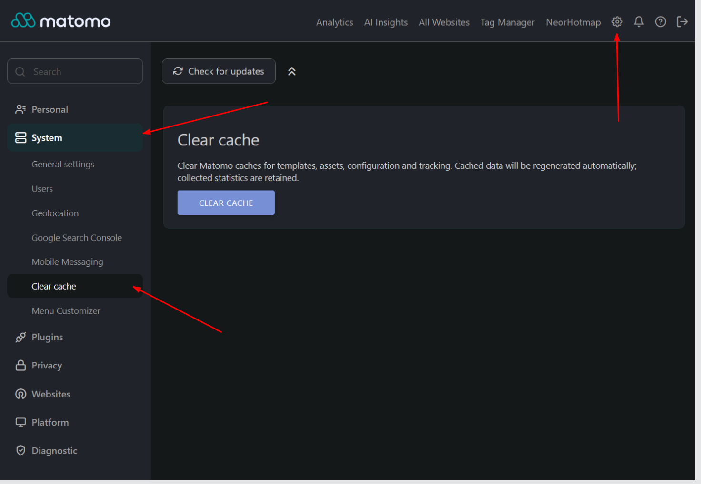

# NeorClearCache

[](CHANGELOG.md)
[](https://matomo.org)
[](https://php.net)
[](LICENSE)

A Matomo 5 plugin that adds a **Clear cache** button under **Administration → System → Clear cache**, allowing administrators to purge the Matomo cache directly from the web interface without requiring terminal or SSH access.



This executes the exact same underlying cache purge routine as the console command:

```bash
php console cache:clear
```

---

## Features

- **Web Administration Access**: Convenient one-click cache purge under **Administration → System → Clear cache**.
- **Complete Cache Purge**: Uses Matomo's standard `Filesystem::deleteAllCacheOnUpdate()`, triggering the core `Filesystem.allCachesCleared` event.
- **Zero Data Loss**: Safely cleans template cache, compiled assets, container definitions, and tracker caches while preserving all statistics, visits, and configuration settings.
- **Strict SuperUser Authorization**: Access restricted strictly to users with SuperUser privileges (`Piwik::checkUserHasSuperUserAccess()`).
- **Robust CSRF & Replay Protection**:
  - Requires a `POST` request with a single-use Matomo token (`Nonce`) passed exclusively via the request body.
  - URL query nonces and replay attacks are rejected.
  - Automatically verifies `Origin` and `Referer` headers through Matomo's native security layer.
  - Regenerates a fresh token immediately after each submission.
- **Multilingual Support**: Out-of-the-box translations for English, German, French, Spanish, Portuguese, Italian, Russian (`en`, `de`, `fr`, `es`, `pt`, `pt-br`, `it`, `ru`).
- **Zero Overhead**: Does not create database tables or background jobs.

---

## Requirements

- **Matomo**: `>= 5.0.0, < 6.0.0` (tested on Matomo `5.14.x`)
- **PHP**: `>= 8.1.0`

---

## Installation

### Via Git

Clone the repository directly into your Matomo `plugins/` directory:

```bash
cd /path/to/matomo/plugins
git clone https://github.com/neor/Matomo-NeorClearCache.git NeorClearCache
```

### Manual Download

1. Download the release archive from [GitHub Releases](https://github.com/neor/Matomo-NeorClearCache/releases).
2. Extract the directory as `NeorClearCache` into the `plugins/` folder of your Matomo installation.
3. Ensure directory permissions allow your web server to read the files.

### Activation

Activate the plugin either through the web interface or via the command line:

- **Web UI**: Log in as a SuperUser, navigate to **Administration (gear icon) → Plugins**, locate **NeorClearCache**, and click **Activate**.
- **CLI**: Run the following command from the Matomo root directory:

```bash
php console plugin:activate NeorClearCache
```

---

## Usage

1. Open **Administration** (gear icon in the top navigation).
2. In the left menu under **System**, click **Clear cache**.
3. Click the **Clear cache** button.
4. A success notification will appear once the cache has been cleared.

> **Note**: The first request immediately after clearing the cache may take slightly longer while Matomo rebuilds its compiled templates and container caches.

---

## Testing

The plugin includes a dedicated security test suite:

```bash
php plugins/NeorClearCache/tests/security.php
```

These standalone tests exercise the controller and the real `Piwik\Nonce` mechanism with isolated mock fixtures. They cover:
- SuperUser access control enforcement for all roles (anonymous, view, admin).
- Rejection of invalid HTTP verbs (`GET`, `HEAD`, `PUT`, `DELETE`).
- CSRF token validation, body-only nonce parsing, replay denial, and token expiration.
- HTTP Origin and Referer validation.
- Error handling when cache deletion fails.
- Twig template rendering and HTML escaping.

---

## Changelog

See [CHANGELOG.md](CHANGELOG.md) for details on releases and changes.

---

## License

This plugin is free software released under the [GNU General Public License v3 or later](LICENSE).

---

## Author

Developed by **Nikolay Lisienko** | [Neor Digital](https://neor.digital/)  
